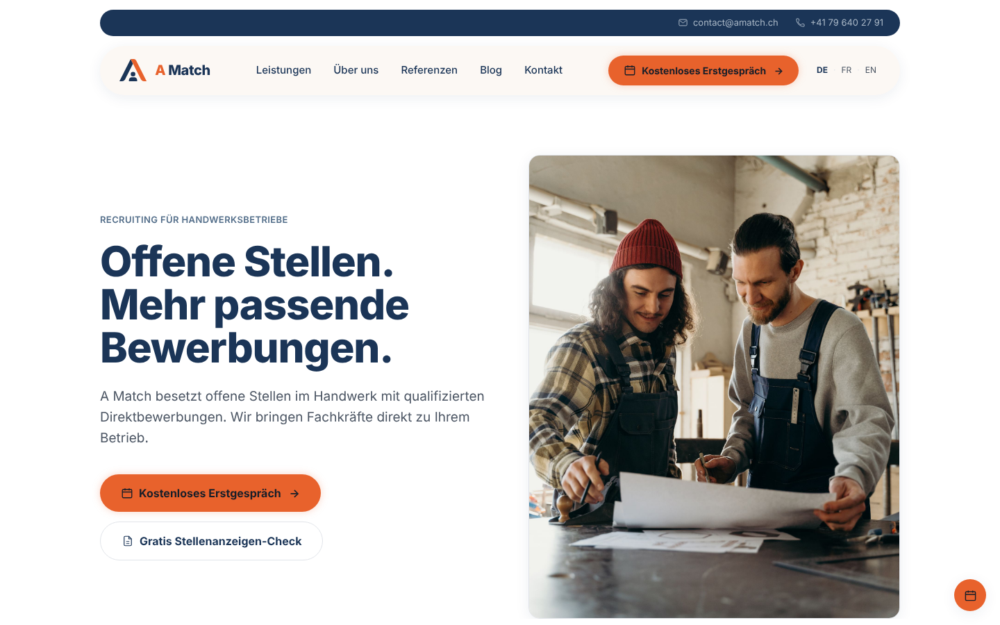
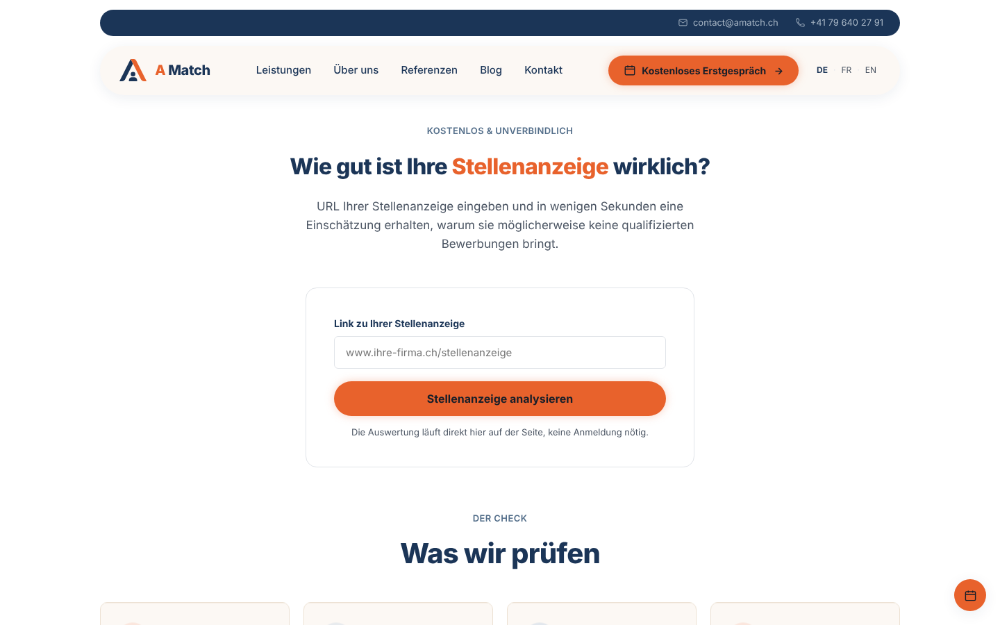
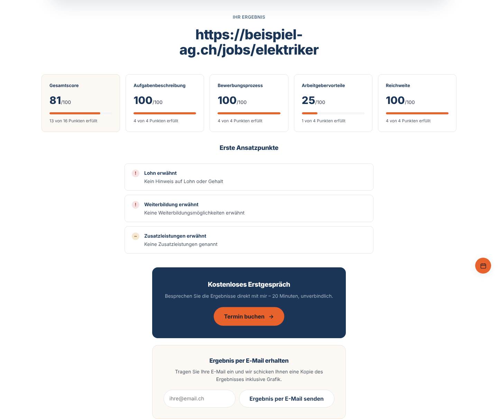
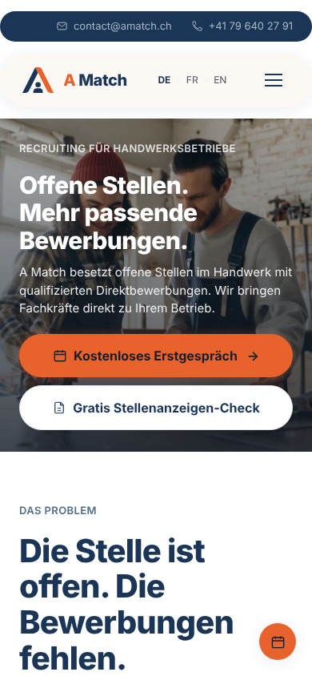

# A Match – website and job-ad check

[](https://github.com/xloui99x/amatch_website/actions/workflows/backend.yml)

Website of **[A Match](https://amatch.ch)**, my recruiting service for Swiss
trade businesses (Handwerksbetriebe), plus the backend for its free
**job-ad check**. I designed, wrote and maintain both.



## What's in here

**A trilingual static website** (German, French, English): service pages,
references, six blog articles per language, booking and legal pages.
Plain HTML, CSS and JavaScript with no framework and no build step, so it
loads fast on a phone at a construction site and can be hosted anywhere.

**The job-ad check**: an owner pastes the link to their job ad and gets a
score with concrete pointers within seconds, optionally by e-mail with a
chart. The analysis runs in a small Python service:
[`amatchwebsiteupload/backend`](amatchwebsiteupload/backend/README.md).

| Check | Result |
|---|---|
|  |  |

## Technical highlights

- **No dependencies in the browser.** One ~300-line script handles the
  mobile navigation, scroll reveal (respecting `prefers-reduced-motion`),
  FAQ accordions and the check UI. Server data is escaped before it touches
  `innerHTML`.
- **Responsive and accessible**: semantic HTML, `aria-expanded` on the menu,
  visible focus states, real `<details>` elements for the FAQ.
- **Backend built for untrusted input.** Visitors make the server fetch any
  URL, so it is hardened against server-side request forgery (private and
  metadata IPs blocked, every redirect re-validated, size and time limits),
  rate-limited and restricted by CORS.
- **Tested.** 94 tests cover every content check, the scoring, SSRF cases,
  the HTTP API and the e-mail. The refactored analysis was verified against
  the previous version on 300 generated job ads with identical results.
  CI runs lint (ruff), strict type checking (mypy) and the tests on every push.

| Mobile |
|---|
|  |

## Structure

```
amatchwebsiteupload/        everything that is deployed
├── *.html                  German pages (default language)
├── fr/, en/                French and English pages
├── styles.css, script.js   shared design and behaviour
├── images/
└── backend/                job-ad check API (Flask) → see its README
docs/screenshots/           images for this README
```

## Run it locally

```bash
# Website
cd amatchwebsiteupload && python3 -m http.server 8000
# → http://localhost:8000

# Backend (second terminal)
cd amatchwebsiteupload/backend
pip install -r requirements-dev.txt
python3 checker_server.py   # → http://localhost:8913, used automatically on localhost
pytest
```

## Deployment

The static files are uploaded to the web host as they are. The backend runs on
Render (`gunicorn checker_server:app`); configuration is described in the
[backend README](amatchwebsiteupload/backend/README.md#configuration).

---

© Louis Amara, A Match. The code may be read and used for reference; texts,
photos and the brand are not licensed for reuse.
